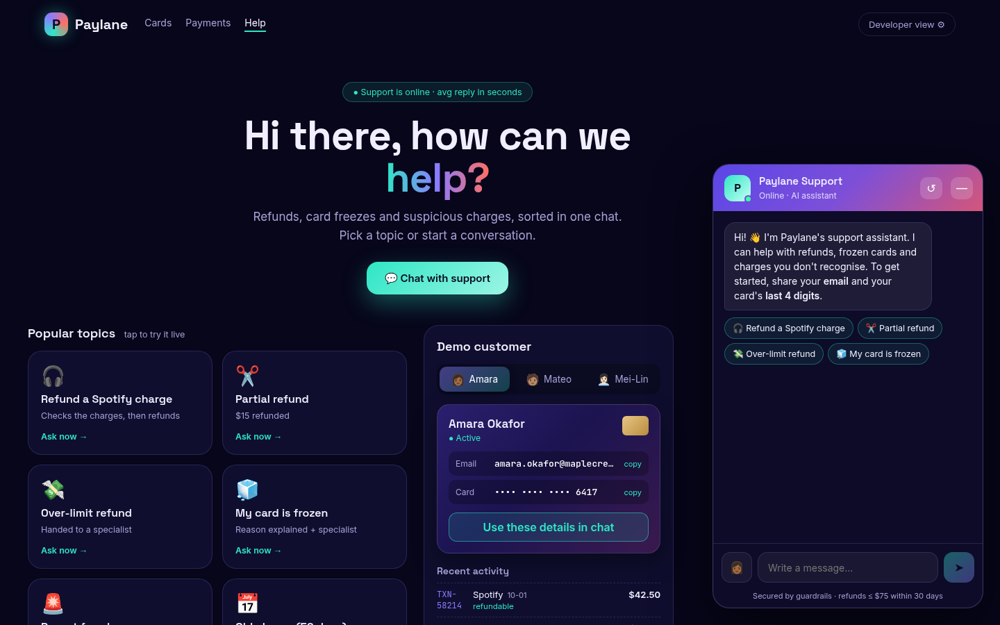
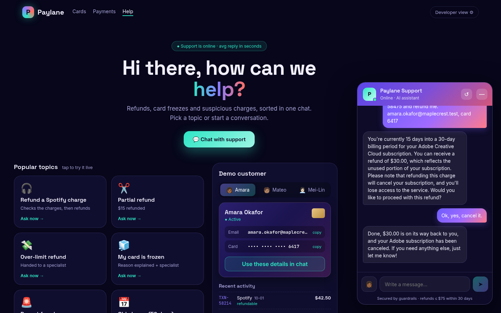
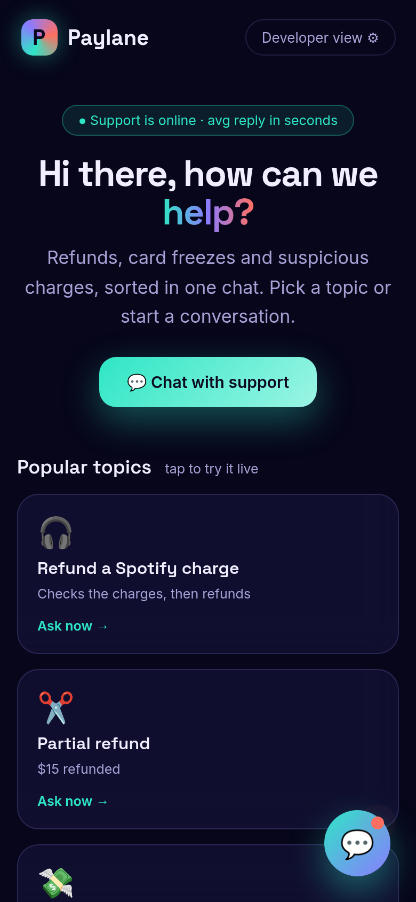
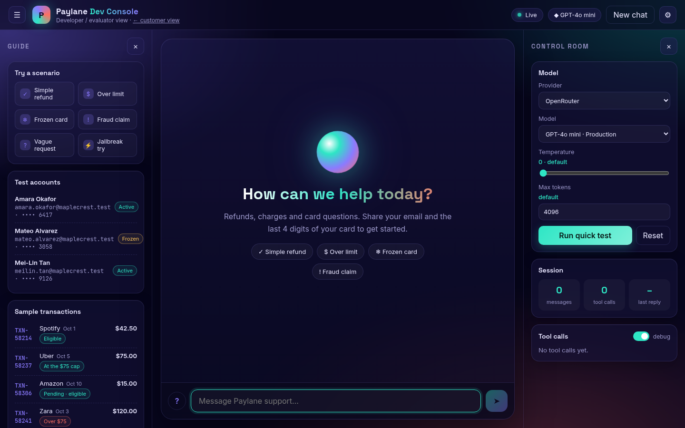
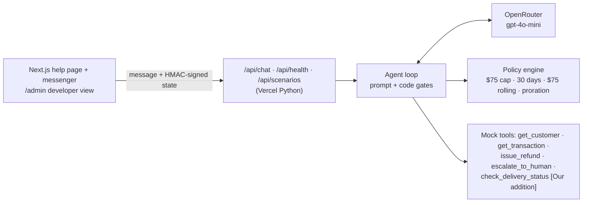
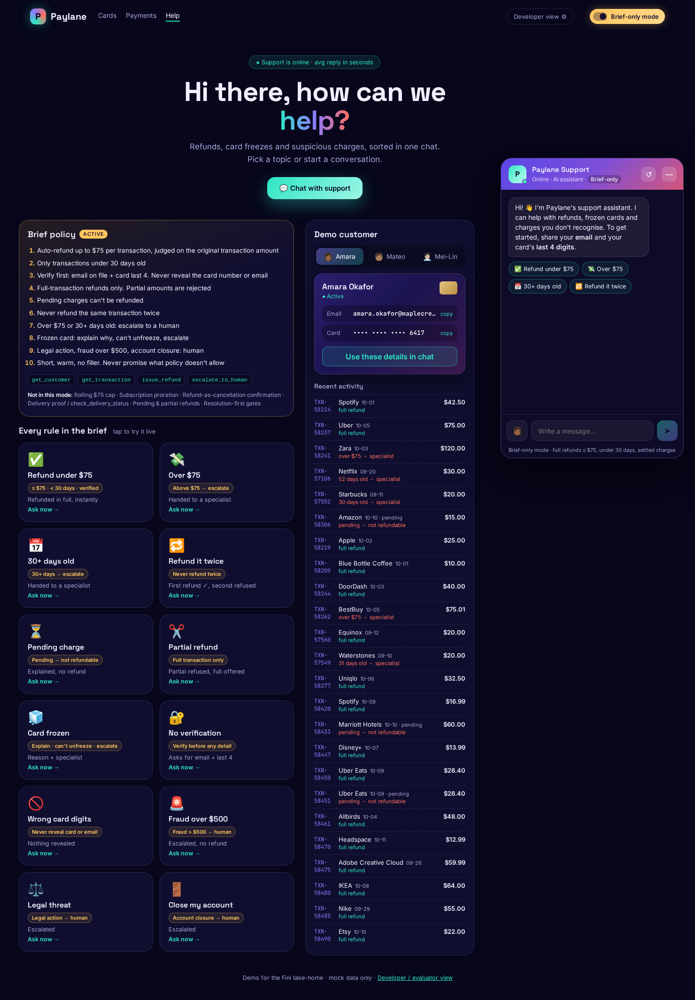
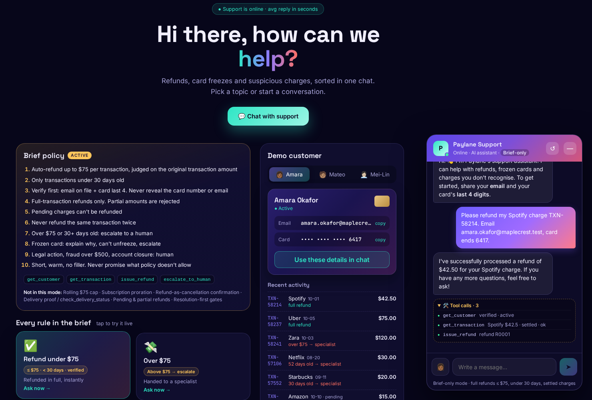

# Paylane support agent (Fini take-home)

An LLM customer-support agent for **Paylane**, a fintech handling cards, transfers and refunds. It verifies customers, works out what went wrong, solves what it can, refunds within policy, and hands everything else to a specialist. The policy is enforced in code, so the model can't be talked out of it.

**Live demo:** https://fini-custmsup-agent.vercel.app · **Developer view:** https://fini-custmsup-agent.vercel.app/admin

**Reviewing against the original brief?** Open **[brief-only mode](https://fini-custmsup-agent.vercel.app/?mode=brief)** · [Brief vs expanded](#brief-only-mode-vs-expanded-mode) · [Boundary trace](traces/brief_boundaries.md)
Model: `openai/gpt-4o-mini` via OpenRouter.

| Real-model eval | Scripted eval | Unit tests |
|---|---|---|
| **26/26** ([transcripts](transcripts/)) | **26/26** | **68/68** |

| Help page | Chat in progress |
|---|---|
|  |  |

| Mobile | Developer / evaluator view |
|---|---|
|  |  |

## What it does

- **Verification** [From Deepak's brief]: email + card last 4 before any account detail. Locks after 3 failed attempts, which isn't caught out by missing details.
- **Refund policy**:
  - [From Deepak's brief] auto-refund only charges of **$75 or less** that are **under 30 days old** (day 30 excluded).
  - [Our addition] partial refunds up to $75, pending charges refundable, no double refunds, and a **$75 total per customer per rolling 30 days**.
- **Always to a human** [From Deepak's brief]: any fraud claim (any amount), legal threats, account closure, frozen cards. The only promise made is that *a specialist will follow up by email*.
- **Resolution first** [Our addition]: explains unfamiliar statement names, hotel holds, posted + pending "duplicates" and subscription cancellation before reaching for a refund. If the customer hasn't said what went wrong, it asks once.
- **Refund = cancellation** [Our addition]: states the consequence (subscription access ends, order cancelled) and waits for a yes.
- **Subscription proration** [Our addition]: full refund on the day of the charge, then only the unused days (Adobe $59.99 on day 15 of 30 → $30.00).
- **Delivery checks** [Our addition, 5th tool `check_delivery_status`]:
  - in transit → wait
  - lost → refund
  - delivered → proof description, or a specialist

## How it fits together



Full diagrams (service split, chat-turn sequence, refund-gate flowchart, verification state machine) are in [docs/architecture.md](docs/architecture.md).

## Brief-only mode vs expanded mode

The agent ships with two policy modes, side by side, so the brief and the extended design can be compared directly.

- **Brief-only mode** runs Deepak's Paylane brief exactly: the 4 spec tools, full-transaction refunds only, eligibility on the original transaction amount, and nothing else.
- **Expanded mode** is the submitted version: the brief plus the resolution-first extras. It stays the default, so the live demo behaves exactly as submitted.

**Switching modes**
- **Help page:** switch on **Brief-only mode** in the top navigation bar, or open `https://fini-custmsup-agent.vercel.app/?mode=brief`. With the switch off, the page is the expanded version exactly as submitted. With it on, the brief's rules panel, its 12 rule-tagged scenario cards, a Brief-only badge in the chat header and a live tool-call trace appear. Switching starts a new chat.
- **API:** `POST /api/chat` with `{"message": "...", "policy_mode": "brief"}`. A conversation keeps the mode it started in, because the mode is stored in the signed state.
- **Server default:** `PAYLANE_POLICY_MODE=brief|expanded` (the default is `expanded`).
- **Evals:** `python -m evals.run --scripted --mode brief`

| Rule | Brief-only mode | Expanded mode |
|---|---|---|
| Auto-refund ≤ $75 per transaction, under 30 days, verified [From Deepak's brief] | ✅ | ✅ |
| Over $75 or 30+ days → escalate [From Deepak's brief] | ✅ | ✅ |
| Never refund the same transaction twice [From Deepak's brief] | ✅ any refund on a transaction closes it | ✅ |
| Verify email + card last 4 before any detail; never reveal them [From Deepak's brief] | ✅ checked in code inside `get_customer` | ✅ via a `verify_customer` helper |
| Frozen card: explain, can't unfreeze, escalate [From Deepak's brief] | ✅ | ✅ |
| Legal action, fraud over $500, account closure → human [From Deepak's brief] | ✅ | ✅ |
| Tools exposed to the model | The 4 spec tools | 4 spec tools + `verify_customer` + `check_delivery_status` [Our addition] |
| Pending charges | Rejected (`pending_not_refundable`) | Refundable [Our addition] |
| Partial refunds | Rejected: full transaction amount only | Allowed up to the remaining amount [Our addition] |
| Eligibility amount | Original transaction amount | Original transaction amount |
| Rolling $75 per customer per 30 days | Not applied | ✅ [Our addition] |
| Subscription proration | Not applied: eligible subscriptions refund in full | ✅ [Our addition] |
| Refund = cancellation, confirmed with a yes | Not applied | ✅ [Our addition] |
| Delivery check + proof of non-delivery | Not applied | ✅ [Our addition] |
| Resolution-first (explain holds and descriptors, ask what went wrong) | Not applied | ✅ [Our addition] |
| 3-strike verification lockout | ✅ [Interpretation of "verify before any account detail"] | ✅ |

| Scores, labelled by mode | Unit tests | Scripted eval (offline) | Real-model eval |
|---|---|---|---|
| **Brief-only mode** (revision 3, Oct 17) | **71/71** (`tests/test_brief_mode.py`) | **28/28** (`--mode brief`) + [boundary trace](traces/brief_boundaries.md) **12/12** | Not run: offline evaluation only, as agreed |
| **Expanded mode** (submitted) | **68/68** | **26/26** | **26/26** on `openai/gpt-4o-mini` (2026-10-14) |

The full suite is 139/139 with either `PAYLANE_POLICY_MODE` setting. Revision 1 (Oct 15) scored 40/40 unit tests and 22/22 scripted; revision 2 (Oct 16) scored 68/68, 28/28 and trace 10/10.

**Brief-only mode revision 3 (Oct 17) and revision 2 (Oct 16), per reviewer feedback.** These changes are brief mode only; expanded mode and its default are unchanged.
- **Revision 3 (Oct 17): elapsed-time age.** Age is the elapsed time from the transaction's UTC timestamp to a fixed reference clock, `REFERENCE_CLOCK_UTC = 2026-10-11T00:00:00Z` (the seed data's `TODAY` at midnight UTC; never the wall clock). Under 30 × 24 h (< 720 h) can qualify; exactly 720 h or more escalates. Date-only fixtures (`YYYY-MM-DD`) mean `YYYY-MM-DDT00:00:00Z`; timestamps with an offset are converted to UTC, and naive timestamps are read as UTC. So `2026-09-11T00:00:01Z` (719h59m59s) is refundable, `2026-09-11` / `2026-09-11T00:00:00Z` (720 h) and `2026-09-10T23:59:59Z` escalate, and `2026-09-11T23:59:59Z` (696 h) is refundable. This replaces revision 2's calendar-date rule.
- *(Revision 2, superseded: age was the calendar-date difference.)*
- After any `escalate_to_human` handoff, code stops refunds on that issue for the rest of the conversation. The stop is kept in the signed state, so it holds across turns.
- Pending charges are still never refunded, and the handoffs still apply: a fraud claim or an immediate-cancellation request on a pending charge escalates to a human, automatically and in code. This holds even with no transaction ID: code finds the pending charge from the customer's transactions by merchant name ("Cancel my pending Amazon charge immediately.") and never asks whether to escalate.
- Legal action, fraud over $500 and account closure go to a human in code: once the customer is verified, code raises the escalation itself and blocks refunds on that issue, even if the model tries to refund.
- The help page now has a clear entry point: a "Reviewing against the original brief? Open brief-only mode" banner, plus the top-line links above.
- [`traces/brief_boundaries.md`](traces/brief_boundaries.md) ([JSON](traces/brief_boundaries.json)) is an offline trace of exactly these boundaries: `python -m evals.brief_trace`.

| Brief-only mode: help page | Brief-only mode: refund with tool calls |
|---|---|
|  |  |

## Docs

| Doc | Contents |
|---|---|
| [docs/architecture.md](docs/architecture.md) | Services, data flow, refund gate, verification state machine |
| [docs/decisions.md](docs/decisions.md) | Dated design decisions (ADR log), tagged brief vs our addition |
| [docs/guardrails.md](docs/guardrails.md) | Every guardrail with its code location |
| [docs/evals.md](docs/evals.md) | Eval layers, scenario list with rationale, how to run |
| [docs/failure_log.md](docs/failure_log.md) | Real failures with transcripts, root cause and fix |
| [docs/customer_note.md](docs/customer_note.md) | Note to Paylane's head of support |
| [docs/live_test_report.md](docs/live_test_report.md), [docs/advanced_testing_guide.md](docs/advanced_testing_guide.md) | Live HTTP harness results and adversarial suite |

## Repo layout

```
paylane/   agent.py (loop + gates)  prompt.py  policy.py  tools.py  data.py  providers.py  catalog.py
api/       chat.py  health.py  scenarios.py  evals.py         (Vercel Python functions)
web/       pages/index.tsx (help page + messenger)  pages/admin.tsx (developer view)
evals/     checks.py  scenarios/ (26)  run.py
tests/     unit tests  ·  live/ (HTTP harness against the deployed API)
transcripts/  real gpt-4o-mini runs   eval_results/  scores
```

## Run it

```bash
pip install -r requirements.txt pytest
pytest -q tests                        # 68 unit tests, no key needed
python -m evals.run --scripted         # 26 scenarios with a scripted model, no key needed

export PAYLANE_PROVIDER=openrouter OPENROUTER_API_KEY=sk-or-... OPENROUTER_MODEL=openai/gpt-4o-mini
python -m evals.run                    # real model; transcripts written to transcripts/

cd web && npm install && npm run dev   # UI on :3000 (point it at a running API or use `vercel dev`)
```

**Deploy:** `vercel deploy --prod` (one project: `@vercel/next` for `web/`, `@vercel/python` for `api/*.py`).
**Environment:** `OPENROUTER_API_KEY`, `OPENROUTER_MODEL`, `PAYLANE_PROVIDER=openrouter`, and optionally `SESSION_SECRET`. Other providers (OpenAI, Anthropic, Ollama) are selected with `PAYLANE_PROVIDER`.

## Demo customers (fictional)

| ID | Name | Email | Card | Status |
|---|---|---|---|---|
| PL-48213 | Amara Okafor | amara.okafor@maplecrest.test | 6417 | active (covers the refund, hold, subscription and order cases) |
| PL-51907 | Mateo Alvarez | mateo.alvarez@maplecrest.test | 3058 | frozen |
| PL-36642 | Mei-Lin Tan | meilin.tan@maplecrest.test | 9126 | active (fraud cases) |

`maplecrest.test` is a reserved domain. `TODAY` is fixed at 2026-10-11, so age rules are deterministic. See [docs/decisions.md](docs/decisions.md#adr-16--seed-data--2026-10-13) for how the data maps to policy edges.
