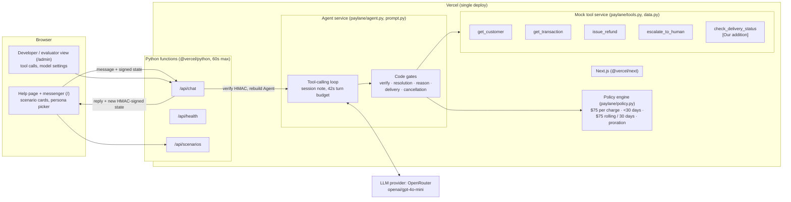
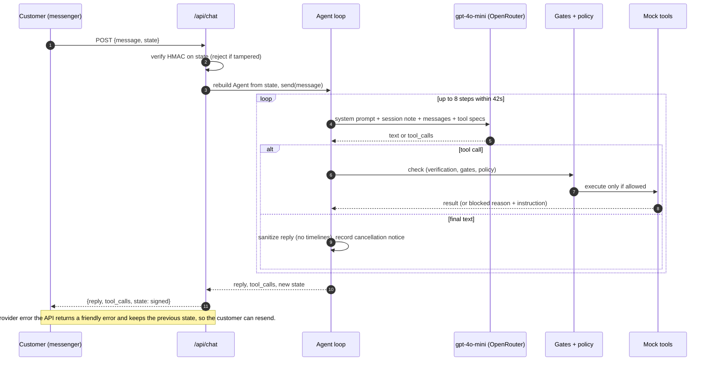
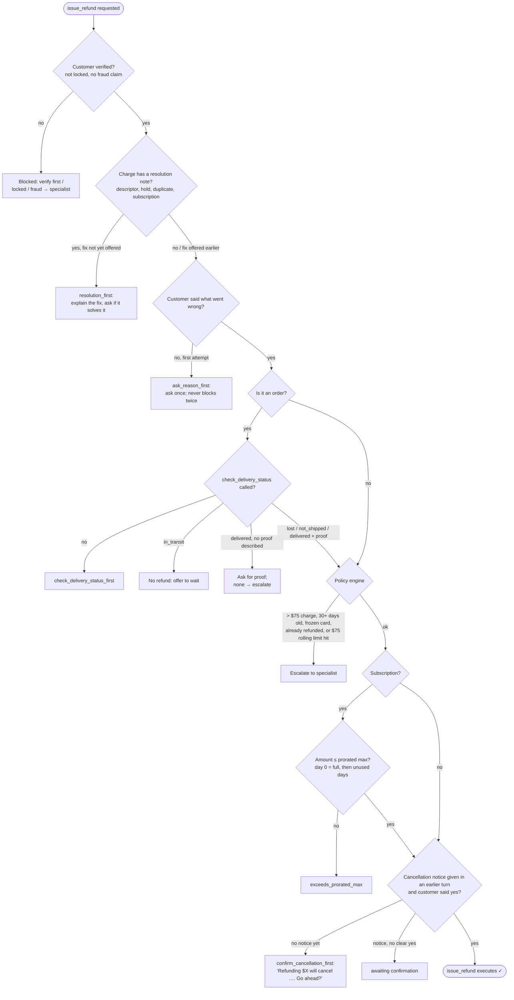

# Architecture

One Vercel project serves the Next.js frontend and the Python API. The agent, the policy engine and the mock bank are Python modules inside the API functions. Each part has its own module and a narrow interface, so any of them can become a separate service later without touching the others.

Tags: **[From Deepak's brief]** = required by the assignment. **[Our addition]** = a design choice we made.

## 1. System and service split



| Layer | Code | Notes |
|---|---|---|
| Frontend | `web/pages/index.tsx`, `web/pages/admin.tsx` | **[Our addition]** Branded help page with a messenger, plus a separate developer view for evaluators. |
| API | `api/chat.py`, `api/health.py`, `api/scenarios.py` | `/api/chat` is stateless. The whole conversation round-trips as an HMAC-SHA256-signed blob (`sign_state` / `verify_state`), so serverless instances share nothing and a tampered blob is rejected. |
| Agent service | `paylane/agent.py`, `paylane/prompt.py` | LLM ↔ tool loop (max 8 steps, 42s budget), code gates, and reply sanitising (no follow-up timelines). |
| Policy engine | `paylane/policy.py` | Deterministic. Runs before every refund executes, so the LLM can't override it. |
| Mock tool service | `paylane/tools.py`, `paylane/data.py` | **[From Deepak's brief]** 4 tools. **[Our addition]** `check_delivery_status`, plus a `verify_customer` helper. Seeded fictional data, with `TODAY = 2026-10-11`. |
| LLM provider | `paylane/providers.py` | OpenRouter (production), OpenAI, Anthropic, Ollama, and a scripted provider for tests. Per-call timeout, fast backoff, overall deadline, and tolerant parsing of tool JSON. |

## 2. One chat turn



## 3. Refund gate (`issue_refund`)

Every refund goes through these checks in order. The first one that fails returns a blocked result with an instruction, which the model passes on to the customer.



## 4. Verification and lockout

```mermaid
stateDiagram-v2
  [*] --> Unverified
  Unverified --> Unverified: missing email or card digits<br/>(asks again, not counted)
  Unverified --> Verified: email + card last 4 match
  Unverified --> Failed1: details don't match
  Failed1 --> Verified: match
  Failed1 --> Failed2: no match
  Failed2 --> Verified: match
  Failed2 --> Locked: 3rd failed attempt
  Locked --> Locked: any details (even correct)<br/>nothing revealed
  Locked --> [*]: auto-escalated:<br/>a specialist follows up by email
  Verified --> FrozenEscalated: card is frozen
  FrozenEscalated --> [*]: reason explained, no refunds,<br/>auto-escalated
  Verified --> [*]: chat continues; identity can't switch mid-chat
```

Before verification the agent reveals nothing: not whether the account exists, not the card status, not any transaction. `get_customer` and `get_transaction` are blocked in code until verification, and `get_customer` never returns `card_last4` to the model.
